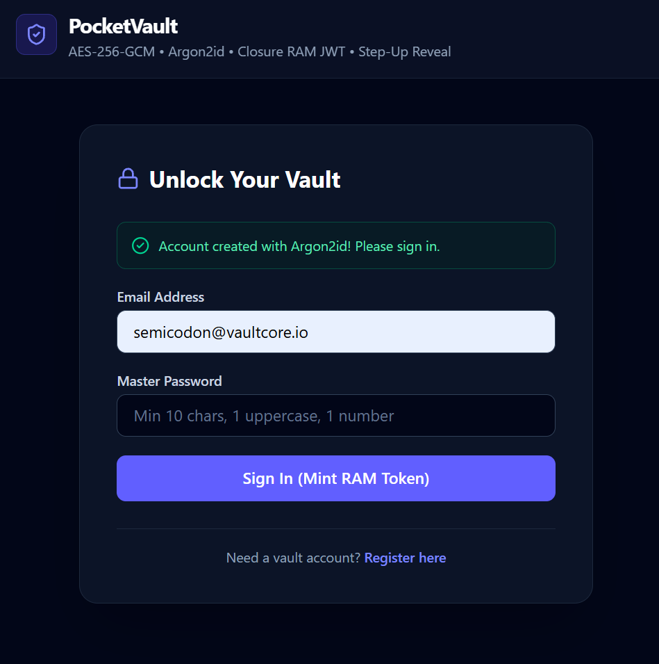
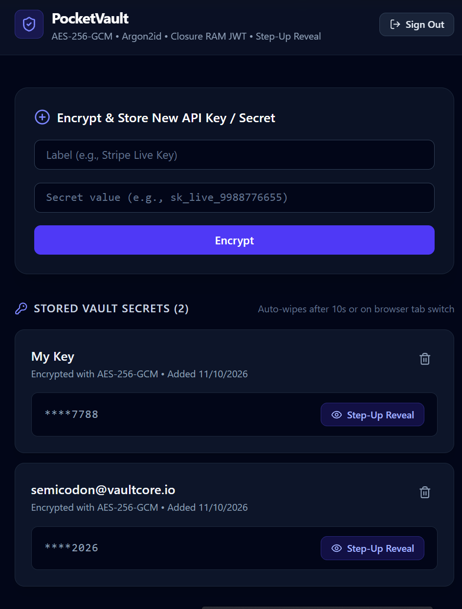

# 🔐 PocketVault — Zero-Trust API Key & Secret Manager

> A full-stack security engineering reference application built with **TypeScript, Express, Prisma (SQLite), and React**. PocketVault demonstrates enterprise-grade application security—authenticated encryption at rest, memory-hard hashing, single-use refresh token rotation, step-up authentication, and ephemeral browser state—in a **zero-Docker, local-first monorepo**.


---

## Why PocketVault?

It is a dangerous practice for plaintext secrets to be stored in a database, return full records to the frontend to mask with CSS (`••••`), and save long-lived JWTs in `localStorage`. In a real setting, this is a critical vulnerability.

**PocketVault** strips away heavy container infrastructure so you can inspect, run, and audit **core full-stack security patterns** in minutes:

1. **Authenticated Field-Level Encryption (`AES-256-GCM`):** Secrets are encrypted in Node.js memory with a fresh $96\text{-bit}$ Initialization Vector (`iv`) and a $128\text{-bit}$ tamper-evident Authentication Tag (`authTag`) *before* touching SQLite.
2. **Data Separation & Masking at Rest:** The database separates `encryptedValue` (`iv:authTag:ciphertext`) from a harmless `maskedPreview` (`"****6655"`). List queries (`GET /api/secrets`) never even `SELECT` the encrypted column.
3. **Zero-`localStorage` Token Architecture:** Short-lived ($15\text{m}$) Access Tokens live exclusively inside a private ES module closure in RAM, paired with a $7\text{-day}$ `HttpOnly; SameSite=Strict` Refresh Cookie.
4. **Single-Use Refresh Token Rotation & Breach Detection:** Every silent refresh consumes the old `jti` (JWT ID) ticket and mints a new one. If a stolen refresh token is replayed, the server detects the reuse and triggers a **Nuclear Kill Switch** (`revokeAllUserSessions`) across all active sessions.
5. **Step-Up Authentication & Self-Destructing UI:** Revealing a secret requires re-verifying the user's master password (`Argon2id`), returns `Cache-Control: no-store`, and automatically scrubs the decrypted plaintext from React memory after **$10\text{ seconds}$** or the instant the user **switches browser tabs** (`visibilitychange`).

---

##  Defense-in-Depth Threat Matrix

| Threat / Attack Vector | How Typical Apps Fail | How PocketVault Defends Against It | Implementation File |
| :--- | :--- | :--- | :--- |
| **Missing / Weak Master Keys** | App boots with `process.env.KEY \|\| ''` and silently encrypts data with an empty key. | **Fail-Fast Pre-Flight Validation:** Zod validates a $64\text{-char}$ hex ($256\text{-bit}$) key and $32+\text{ char}$ JWT secrets at boot or halts with `process.exit(1)`. | `backend/src/config/env.ts` |
| **Database Breach / SQL Dump** | API keys stored in plaintext or reversible encoding without tamper checks. | **`AES-256-GCM` Authenticated Encryption:** Unique $12\text{-byte}$ random `iv` + $16\text{-byte}$ `authTag` integrity seal per secret. | `backend/src/utils/crypto.ts` |
| **Accidental API Data Leak** | `GET /secrets` returns full rows; frontend hides secrets visually with CSS. | **Schema-Level Masking:** `GET /api/secrets` selects only `maskedPreview` (`"****6655"`). `encryptedValue` stays in SQLite. | `backend/prisma/schema.prisma` |
| **GPU Password Cracking** | Fast hashing (`SHA-256` or low-cost `bcrypt`) allows billions of guesses/sec. | **Memory-Hard `Argon2id`:** Allocates $64\text{ MB}$ of RAM (`memoryCost: 65536`) per hash to starve GPU cracking rigs. | `backend/src/routes/auth.routes.ts` |
| **XSS Token Theft** | JWT stored in `localStorage` is stolen by any injected script via `localStorage.getItem()`. | **Closure RAM Token + `HttpOnly` Cookie:** Access token lives in a private module variable; Refresh token is locked in an `HttpOnly; SameSite=Strict` cookie. | `frontend/src/api/secureClient.ts` |
| **Stolen Refresh Token Replay** | Stateless $7\text{-day}$ refresh token remains valid until expiration even after logout. | **Stateful `jti` Rotation + Nuclear Switch:** Single-use `jti` tickets rotate on every refresh. Replaying a used `jti` revokes **all** sessions for that user. | `backend/src/db/sessionStore.ts` |
| **BOLA / IDOR Attacks** | User A passes User B's secret UUID to `/secrets/:id/reveal` and unlocks it. | **Strict Object Ownership Check:** Every reveal and delete query verifies `secret.userId === req.user.id` before touching crypto. | `backend/src/routes/secrets.routes.ts` |
| **Unlocked Laptop / Shoulder Surfing** | Anyone walking past an open browser tab can click "Show" or read revealed keys. | **Step-Up Auth + Ephemeral UI:** Demands master password re-entry on `/reveal`, sets `Cache-Control: no-store`, and wipes RAM after $10\text{ s}$ or on tab switch. | `frontend/src/components/SecretCard.tsx` |
| **Credential Stuffing / Brute Force** | Unlimited login or decryption attempts from automated scripts. | **Two-Tier Rate Limiting:** Locks out `/auth/*` and `/secrets/:id/reveal` after $5$ attempts per $15\text{ minutes}$. | `backend/src/middleware/rateLimiter.ts` |

---

## Structure

```text
pocket-vault/
├── .env.example                          # Safe environment variable contract
├── .gitignore                            # DLP rules blocking .env and *.db files
├── README.md                             # Project overview & security audit guide
├── backend/
│   ├── package.json                      # Hardened Express & crypto dependencies
│   ├── tsconfig.json                     # Strict compile-time safety guardrail
│   ├── prisma/
│   │   └── schema.prisma                 # User & VaultSecret models (encrypted vs masked)
│   └── src/
│       ├── config/
│       │   └── env.ts                    # Fail-fast Zod environment validator
│       ├── db/
│       │   ├── prisma.ts                 # Redacted PrismaClient singleton
│       │   └── sessionStore.ts           # Stateful JTI refresh session registry
│       ├── middleware/
│       │   ├── auth.ts                   # Zero-trust Bearer JWT gatekeeper
│       │   └── rateLimiter.ts            # General (100/15m) & strict (5/15m) limiters
│       ├── routes/
│       │   ├── auth.routes.ts            # Argon2id auth, HttpOnly cookies & JTI rotation
│       │   └── secrets.routes.ts         # Masked list, BOLA guard & step-up /reveal
│       ├── utils/
│       │   └── crypto.ts                 # AES-256-GCM encrypt/decrypt & preview masker
│       └── index.ts                      # Helmet, strict CORS, 10kb cap & error sanitizer
├── frontend/
│   ├── index.html                        # Browser Content-Security-Policy & no-referrer
│   ├── vite.config.ts                    # Strict port 5173 + same-origin /api proxy
│   └── src/
│       ├── api/
│       │   └── secureClient.ts           # Closure RAM token vault & single-flight refresh
│       ├── components/
│       │   └── SecretCard.tsx            # Step-up password drawer, 10s timer & tab wipe
│       └── App.tsx                       # Silent F5 session bootstrapper & vault dashboard
└── docs/                                 # Deep-dive phase guides & architecture lessons
```

---

## Quick Start

### Prerequisites
* **Node.js** `v20+` (or `v22+`)
* **OpenSSL** (pre-installed on macOS, Linux, and Git Bash / WSL on Windows)

### 1. Clone & Configure Environment Secrets
```bash
git clone <your-repo-url> pocket-vault
cd pocket-vault
cp .env.example .env
```

Generate your $256\text{-bit}$ ($64\text{-character}$ hex) master encryption key and JWT secrets:
```bash
# Run these in your terminal and paste the outputs into .env:
openssl rand -hex 32   # Paste into ENCRYPTION_KEY
openssl rand -hex 32   # Paste into JWT_ACCESS_SECRET
openssl rand -hex 32   # Paste into JWT_REFRESH_SECRET
```

### 2. Install & Migrate the Hardened Backend
```bash
cd backend
npm install

# Link root .env for Prisma CLI and run the SQLite migration
ln -s ../.env .env
npx prisma migrate dev --name init_pocket_vault

# Start the backend API on http://127.0.0.1:4000
npm run dev
```

### 3. Install & Launch the React Frontend
Open a **second terminal tab** from the project root:
```bash
cd frontend
npm install

# Start the Vite server on http://localhost:5173
npm run dev
```

Open **`http://localhost:5173`** in your browser!

---

# API Security Contract

| Method & Endpoint | Auth Required | Rate Limit Tier | Security Behavior |
| :--- | :--- | :--- | :--- |
| `GET /health` | Public | None | Returns service health status with `Helmet` headers. |
| `POST /api/auth/register` | Public | **Strict** ($5 / 15\text{m}$) | Validates strong password via Zod; hashes with `Argon2id` ($64\text{ MB}$). |
| `POST /api/auth/login` | Public | **Strict** ($5 / 15\text{m}$) | Verifies `Argon2id`; returns $15\text{m}$ RAM JWT + sets $7\text{d}$ `HttpOnly` `jti` cookie. |
| `POST /api/auth/refresh` | `HttpOnly` Cookie | General ($100 / 15\text{m}$) | Verifies `jti` in `sessionStore`, rotates ticket, or revokes all sessions on reuse. |
| `POST /api/auth/logout` | `HttpOnly` Cookie | General ($100 / 15\text{m}$) | Deletes server-side `jti` session and clears `pocketvault_refresh` cookie. |
| `GET /api/secrets` | `Bearer` JWT | General ($100 / 15\text{m}$) | Returns **only** `id`, `title`, `maskedPreview`, `createdAt` (never `encryptedValue`). |
| `POST /api/secrets` | `Bearer` JWT | General ($100 / 15\text{m}$) | Encrypts secret with `AES-256-GCM` (`iv:authTag:ciphertext`) + saves last-4 hint. |
| `POST /api/secrets/:id/reveal` | `Bearer` JWT + **Password** | **Strict** ($5 / 15\text{m}$) | Enforces BOLA ownership + `Argon2id` step-up check; returns `Cache-Control: no-store`. |
| `DELETE /api/secrets/:id` | `Bearer` JWT | General ($100 / 15\text{m}$) | Enforces BOLA ownership check before deleting row from SQLite. |

---

## 4 Live Browser DevTools Security Audits

Want to see the security mechanics in action? Open **Browser DevTools (`F12`)** while running PocketVault on `http://localhost:5173`:

1. **Audit #1 — Zero `localStorage` Check (Anti-XSS):**
   * Register and sign in.
   * Open **Application** $\rightarrow$ **Local Storage** and **Session Storage**. Both are **100% empty**.
   * Open **Application** $\rightarrow$ **Cookies**. Inspect `pocketvault_refresh` and verify **`HttpOnly: ✓`** and **`SameSite: Strict`**.
2. **Audit #2 — Silent Refresh & Single-Use `jti` Rotation (`F5` Test):**
   * Press `F5` to reload the page. Notice you remain signed in even though the RAM closure variable was wiped!
   * In the **Network** tab, click `POST /api/auth/refresh` and verify the `Set-Cookie` response header issued a brand-new `jti` ticket while invalidating the previous one.
3. **Audit #3 — Zero-Leak Network Payload Check:**
   * Encrypt a new secret (e.g., `sk_live_9988776655`).
   * In the **Network** tab, inspect the JSON response of `GET /api/secrets`. Confirm it contains `"maskedPreview": "****6655"` and **never** transmits `encryptedValue` or plaintext.
4. **Audit #4 — Step-Up Decryption, $10\text{s}$ Self-Destruct & Tab-Switch Wipe:**
   * Click **Step-Up Reveal** on your secret and enter your master password.
   * Watch the live $10\text{s}$ countdown badge. Before it hits $0\text{s}$, click any other browser tab and switch back—verify the secret **instantly wiped itself from the DOM and React state** the moment the tab lost visibility!

---
### Register Page


---
### Logged in - Encryption Page
